<p align="center">
  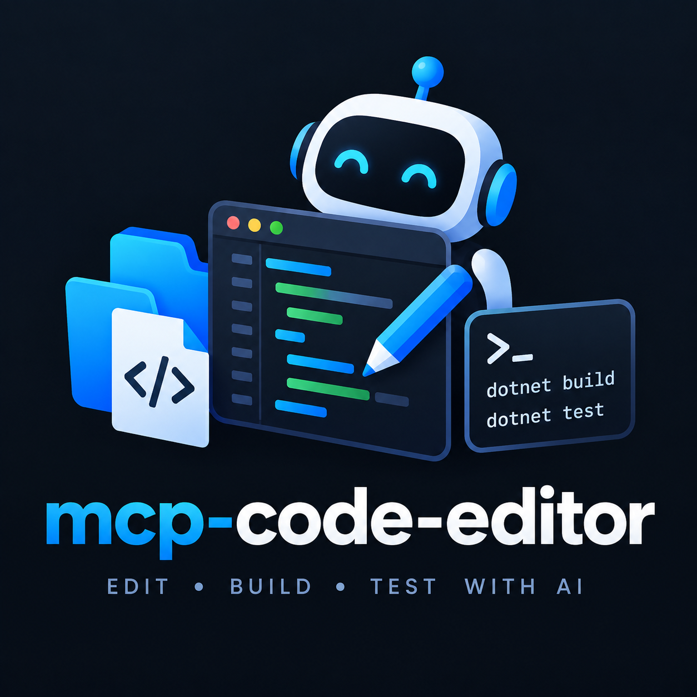
</p>

<h1 align="center">mcp-code-editor</h1>

<h2 align="center">CONNECT THE AI AGENT FROM YOUR WEB CHAT<br>TO THE PROJECT ON YOUR COMPUTER</h2>

<p align="center">
  <b>Built for one job:</b> let the AI agent you already use in the browser —
  any web chat that accepts custom MCP connectors — work directly on your real project:
  read it, edit it, build it, test it.
</p>

<p align="center">
  <b>No more copy-paste between the chat and your editor.</b> · No API key — your chat subscription is enough. · Free.
</p>

## 1. Overview

**mcp-code-editor gives the AI agent in your web chat access to the project on your computer.**

A web chat cannot see the files on your computer.
So you copy code into the chat, paste the answer back, and hope it fits.
mcp-code-editor removes that: the agent reads, edits, builds and tests your real project, while you keep chatting in the browser.

### Why use it

- **For the web chat you already use.** Desktop and command-line agents (in an IDE or a terminal) work on local files, but a web chat cannot. mcp-code-editor is the missing link for the web chat.
- **No API key, no extra subscription.** The agent is the one in your chat, with the model and the plan you already have.
- **Simple to set up.** One line installs it: no administrator rights, no .NET, Node or Python to install, no configuration files. Then you press **Start** and paste one URL into your chat.
- **Light enough for any computer.** Useful for routine work on a computer where no desktop or command-line agent is installed. (Check that your organization allows it: while it runs, the project is reachable through a secure tunnel.)
- **The whole project, not fragments.** The agent searches all files, navigates the code like an IDE (definitions, references, compiler errors), builds and runs the tests, and fixes its own errors.
- **You stay in control.** Every command waits for your approval. Secret files are hidden. Every change is logged. You review the result with Git. See [Security](#8-security).

**When you don't need it:** if you already work with a desktop or command-line agent that has access to your project.

| Without mcp-code-editor | With mcp-code-editor |
|---|---|
| You copy files into the chat, one by one | The agent reads and searches the whole project itself |
| You paste the answer back and hope it fits | The agent edits the files on disk, precisely |
| "Does it compile?" — you find out later | The agent builds, runs the tests and fixes its own errors |
| The chat guesses names and signatures | The agent navigates the code like an IDE: definitions, references, compiler errors |

**Three steps:** install with one line → press **Start** on your project folder → paste the **Endpoint** URL into your chat as a connector. That is all ([Installation](#3-installation), [Connect](#6-connect-an-mcp-client)).

### Features

- No account or sign-up.
- The agent sees the whole project: files, code structure, compiler errors, references between symbols (C#, Python, JavaScript/TypeScript, HTML, CSS).
- The agent can view screenshots and diagrams from the project.
- **Read-Only** and **Read-Write** modes.
- Every command the agent wants to run is shown to you for approval (default).
- Secret files (`.env`, keys, certificates) are hidden from the agent by default.
- Files ignored by `.gitignore` are hidden from listings and searches.
- Every file change is recorded in an audit log.
- Public HTTPS endpoint through Cloudflare Tunnel, protected by OAuth 2.1.
- One window per project; several projects can run in parallel.
- Automatic updates.

<p align="center">
  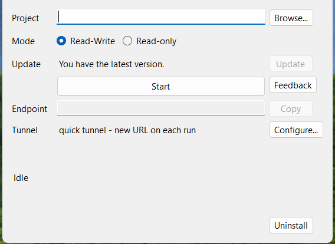
</p>

## 2. Requirements

- Windows 10/11 x64
- PowerShell
- Internet access

No administrator rights, .NET installation or separate installer are required.

**Optional: code intelligence** (compiler errors, go to definition, references).
Install what your project's language needs:

| Language | What to install |
|---|---|
| C# | the .NET SDK |
| Python | `pyright-langserver` |
| JavaScript / TypeScript | `typescript-language-server` |
| HTML | `vscode-html-language-server` |
| CSS | `vscode-css-language-server` |

The language servers must be on `PATH`.
Without them everything else keeps working. The agent is told that code intelligence is unavailable for that language.

## 3. Installation

1. Press **Win+R**, type `powershell` and press **Enter**.
2. Paste this line and press **Enter**:
   ```powershell
   irm https://raw.githubusercontent.com/DomitorAI/mcp-code-editor/main/scripts/bootstrap.ps1 | iex
   ```

**You should see:** a **mcp-code-editor** shortcut on your desktop.

The application and Cloudflared are installed in `%LOCALAPPDATA%\mcp-code-editor\`.

## 4. Start

1. Launch **mcp-code-editor**.
2. On **Project**, press **Browse...** and select the project folder.
3. On **Mode**, select **Read-Write** or **Read-Only**.
4. Optional: on **Tunnel**, press **Configure...** to use a named tunnel (see below).
5. Press **Start**.
6. Copy the public URL from **Endpoint**.

To work on several projects at the same time, open one window per project. The same project cannot be opened in two windows.

## 5. Tunnels

| | Quick tunnel (default) | Named tunnel |
|---|---|---|
| Cloudflare account | Not required | Your own account |
| Public URL | Random `*.trycloudflare.com`, new on every start | Your addresses, stable |
| Setup | None | One Cloudflare tunnel with one route per address, entered once in **Tunnel → Configure...** |
| Best for | Testing, occasional use | Everyday use with saved connectors |
| Ports | 8080–8084, then 8090 and up (first free) | 8085–8089, one per address |

The Cloudflare token stays on your computer.

### Rules

- One token and your domain give 1 to 5 fixed addresses (you choose how many): `mcp1.<your domain>` on port **8085**, `mcp2` on **8086**, up to `mcp5` on **8089**. The application forms the addresses and ports; you do not type them.
- **Every fixed address you choose needs its own route in Cloudflare, with exactly its port.** **Tunnel → Configure...** shows the routes to add.
- At **Start**, a window takes a free fixed address: the one its project had last time if it is free, otherwise the first free one. It keeps it until the window is closed, also after **Stop** or a loss of internet.
- If the port of an address is used by another program, that address is skipped.
- When all fixed addresses are in use, the window uses a temporary address (quick tunnel) and says so.
- The quick tunnel never uses ports 8085–8089.

### Set up a named tunnel

Do the steps in this order: first everything in Cloudflare, then the application.

**1. Cloudflare account and domain.** Create a free account at [dash.cloudflare.com](https://dash.cloudflare.com/sign-up). Register a domain there (**Domain Registration → Register Domains**) or add one you already own (**Add a domain**). The domain must show **Active**.

**2. Decide how many windows need a fixed address** (1 to 5). The addresses and ports are fixed:

| Address | Port |
|---|---|
| `mcp1.<your domain>` | 8085 |
| `mcp2.<your domain>` | 8086 |
| `mcp3.<your domain>` | 8087 |
| `mcp4.<your domain>` | 8088 |
| `mcp5.<your domain>` | 8089 |

With 2 addresses you use only the first two lines.

**3. Create the tunnel.** **Networking → Tunnels → Create Tunnel**, type **Cloudflared**, give it a name. On **Setup Environment**, choose **Windows** and copy only the token from the command shown (the long text starting with `eyJ`). Do not run the command: the application starts the tunnel itself. Keep the token secret. **Continue** stays disabled until the application connects; you can leave this page, the tunnel is saved.

**4. Add one route per address.** Open the tunnel (**Networking → Tunnels → your tunnel**), tab **Routes**, press **Add route**:

<p align="center">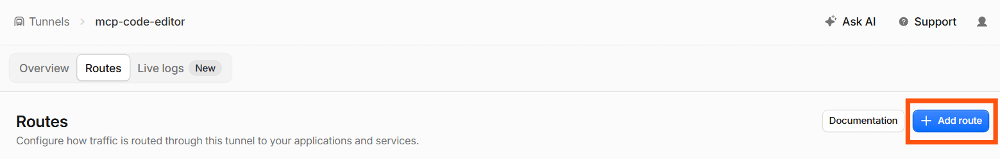</p>

Choose **Published application**:

<p align="center">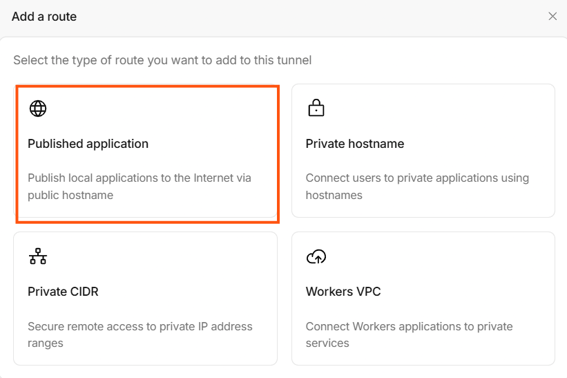</p>

Enter **Subdomain** `mcp1`, your **Domain**, and **Service URL** `http://localhost:8085`, then **Add route**. Repeat for `mcp2` with `8086`, and so on, for each address from step 2:

<p align="center">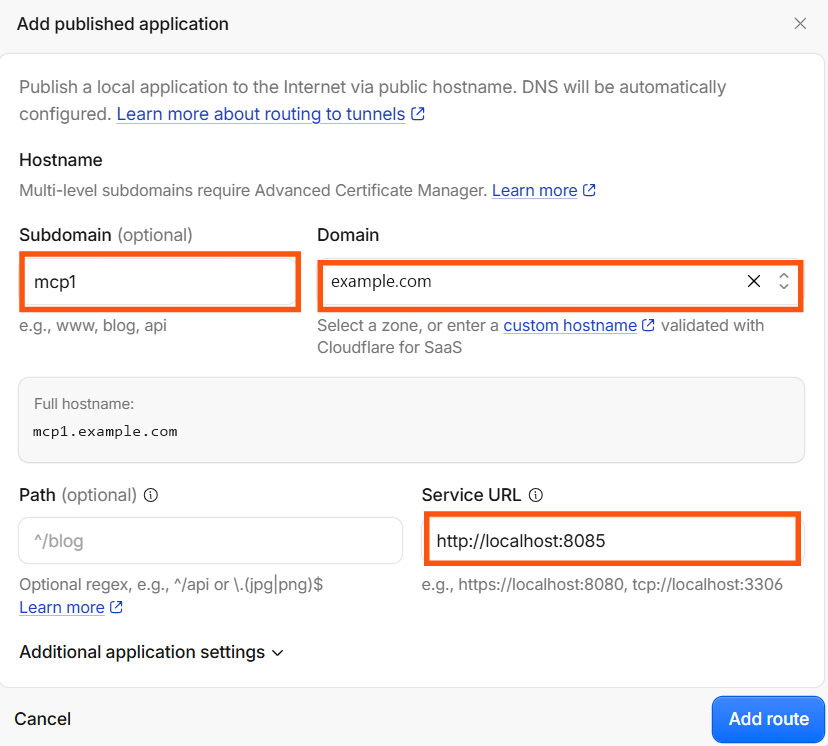</p>

**5. Enter the settings in the application.** **Stop** if the server runs, then press **Configure...** on the **Tunnel** row:

<p align="center">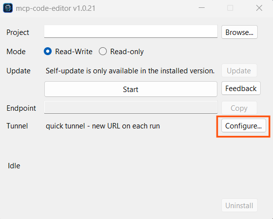</p>

Enter the token, your domain (for example `example.com`) and the **Number of fixed addresses** from step 2. The dialog lists the routes, for example `mcp1.example.com -> http://localhost:8085`: they must be exactly the routes you added in step 4. **Save**.

<p align="center">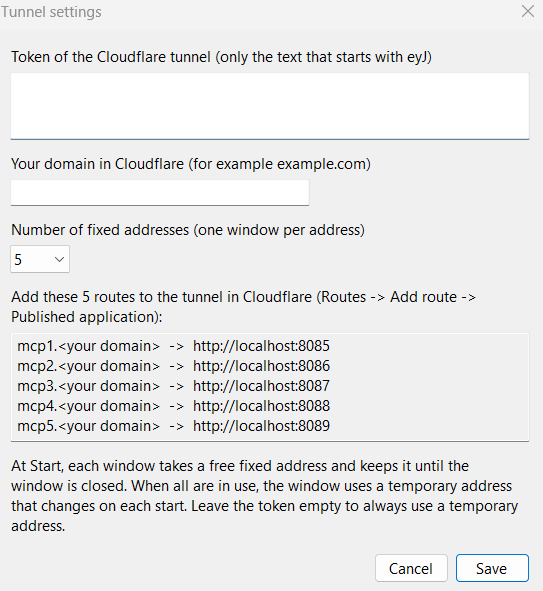</p>

**6. Start.** Press **Start**. The **Tunnel** row shows the address of the window and the Endpoint is `https://<address>/mcp`, the same on every start. In Cloudflare the tunnel shows **Healthy**.

**7. Connect your AI chat** once per address ([Connect an MCP Client](#6-connect-an-mcp-client)).

If an address is not found right after you added its route, wait: DNS servers may remember the "not found" answer for up to 30 minutes. On Windows, `ipconfig /flushdns` clears your computer's copy.

Use a separate tunnel (its own token and addresses) on each computer: the same token on two computers would share the requests between them.

### If the public URL stops working

**The Endpoint row is empty and Status says Cloudflared stopped.**
Press **Stop**, then **Start**.

**Status turns red, the taskbar button flashes and a sound plays.**
The URL stopped responding while the application runs, for example after the computer slept.
The application notices this within about a minute.
- If the URL recovers by itself, the warning clears.
- If not, press **Stop**, then **Start**.

**Right after Start, the URL does not answer yet.**
A new quick-tunnel URL can take a minute or two to become reachable. The warning waits for it.

## 6. Connect an MCP Client

Use the **Endpoint** URL as the MCP server URL in your AI chat or local MCP client, with **OAuth** authentication. Support for custom MCP servers depends on the client.

### Example: the web agent of ChatGPT

As an example, these are the steps to connect the web agent of ChatGPT.
Other web chats that accept custom MCP connectors are connected the same way: the **Endpoint** URL as the server URL, with OAuth.

Menu names and locations in ChatGPT may change.

1. Open the account menu and select **Settings**.

<p align="center">
  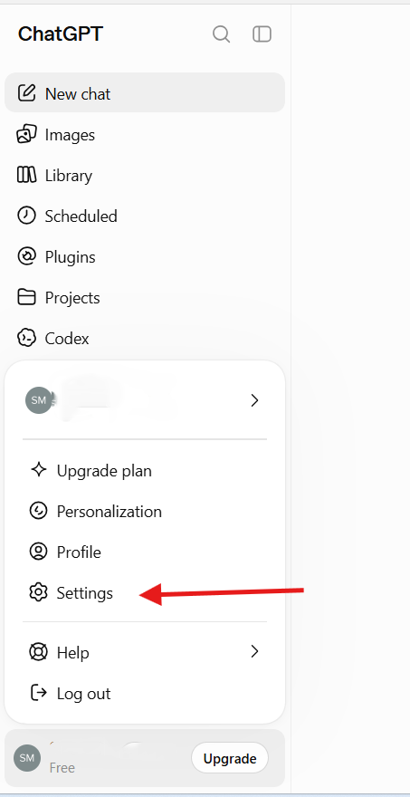
</p>

2. In **Settings → Plugins**, open **Developer mode**.

<p align="center">
  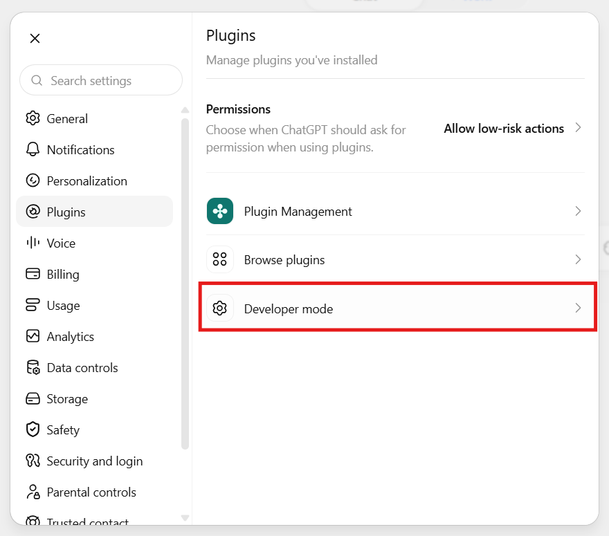
</p>

3. Enable **Developer mode**. This allows unverified connectors and displays an **ELEVATED RISK** warning.

<p align="center">
  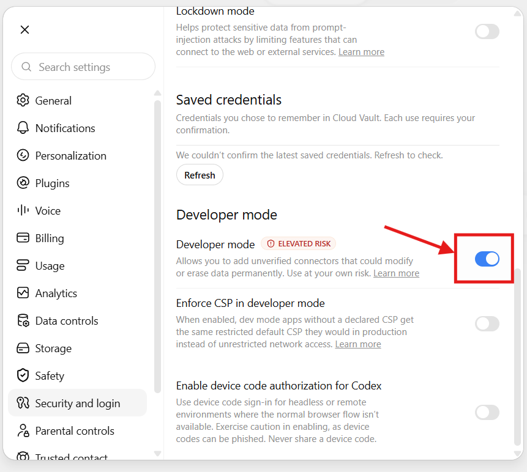
</p>

4. Open **Plugins** and press **+**.
   - If the connector form opens, continue with step 5.
   - If a menu opens instead, select **Create app**. In the **New Plugin** window that follows, do not upload anything — press **Create MCP App** at the bottom left. The connector form (step 5) opens.

<p align="center">
  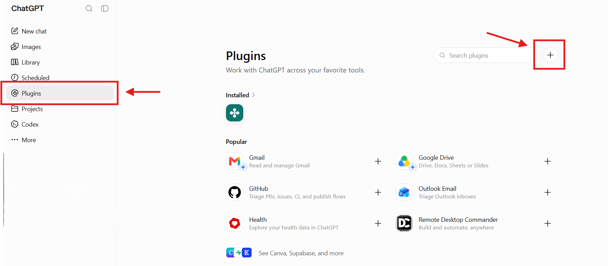
</p>

<p align="center">
  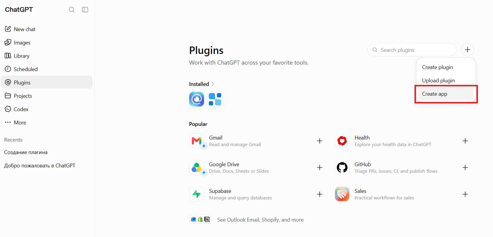
</p>

<p align="center">
  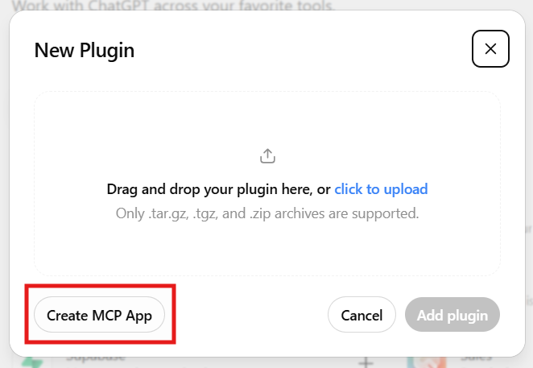
</p>

5. Enter a connector name and the current **Endpoint** as **Server URL**. Keep **Authentication: OAuth** and confirm the acknowledgement.

<p align="center">
  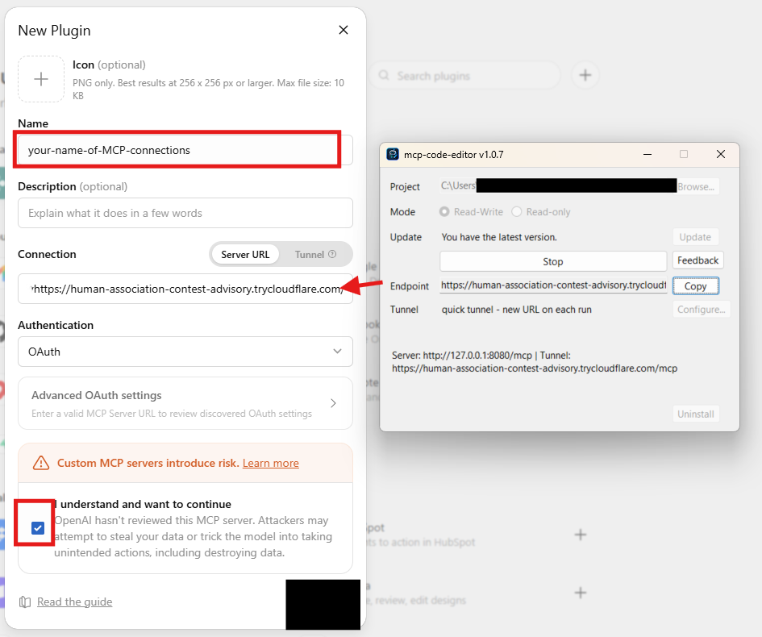
</p>

6. On the consent screen, press **Sign in with …**. The button shows the connector name you entered in step 5.

<p align="center">
  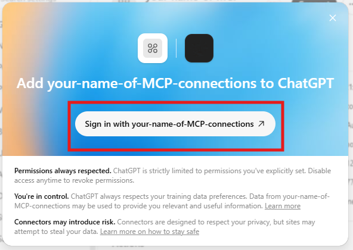
</p>

7. In **Settings → Plugins**, open the connector. The **⋯** menu offers **Reconnect**, **Disconnect** and **Delete**.

<p align="center">
  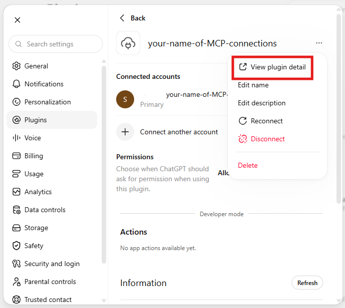
</p>

8. Press **View plugin detail**, then **Try in chat**.

<p align="center">
  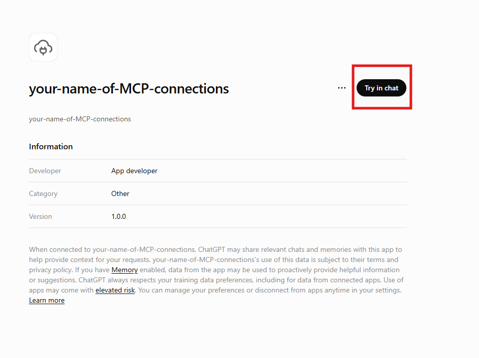
</p>

9. A new chat opens. Close the **Meet ChatGPT Work** panel with the **X** in the top-right corner.

<p align="center">
  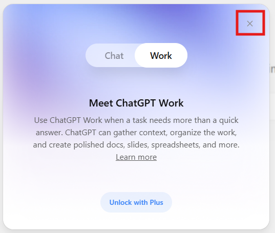
</p>

10. The connector is attached to the input box. Type your request and send it.

<p align="center">
  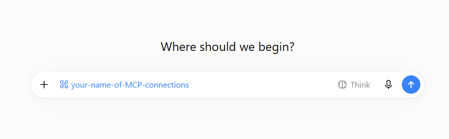
</p>

### After a restart (quick tunnel)

Every start of a quick tunnel creates a new URL, and the saved connector still points to the old one. To reconnect:

1. Copy the new URL from **Endpoint**.
2. In ChatGPT, open **Settings → Plugins** and find the existing connector.

<p align="center">
  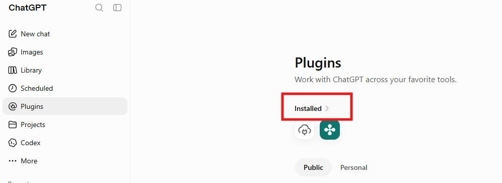
</p>

<p align="center">
  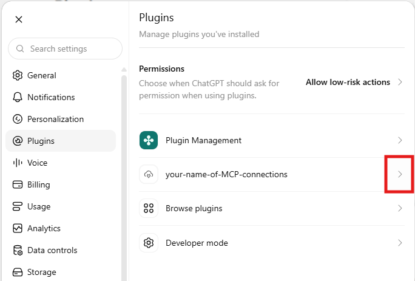
</p>

3. Open the **⋯** menu and select **Delete**.

<p align="center">
  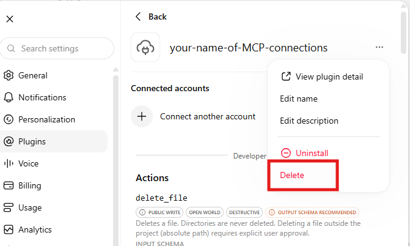
</p>

4. Create the connector again with the new **Endpoint** ([steps 4–10](#example-the-web-agent-of-chatgpt) above) and sign in again.

With a **named tunnel**, the URL does not change, so this is not needed.

## 7. Using the Agent

Tell the agent which project to work on, if needed:

```text
Work on C:\path\to\your-project
```

Then ask as you would ask a developer:

```text
Fix the bug in X.
Add feature Y.
Run the tests.
Look at the screenshot docs/login.png and fix the layout.
```

The agent reads and searches the project, edits files, builds and tests it, and reports back. Review the result before committing:

```powershell
git diff
```

You remain responsible for the prompts, the changes you keep, and your commits and pushes.

### What the agent can do

| Tool | What it does |
|---|---|
| `list_projects` | Lists the available projects. |
| `list_files` | Lists files and folders. |
| `read_file` | Reads a text file. Also reads the text of Word (`.docx`) and PDF documents. |
| `read_image` | Views an image (PNG, JPEG, GIF, WebP). |
| `search_code` | Searches the project text. |
| `edit_file` | Changes a precise piece of a file. |
| `write_file` | Creates or replaces a file. |
| `delete_file` | Deletes a file (never a folder). |
| `run_build` / `run_tests` | Builds / tests a .NET project. |
| `run_command` | Runs any other command (build, test, lint) — after your approval. |
| `get_diagnostics` | Lists compiler errors. |
| `go_to_definition` / `find_references` / `get_symbol_info` | Navigates the code like an IDE. |

In **Read-Only** mode, only the reading, searching and code-navigation tools are available.

## 8. Security

### What the agent can reach

- The agent works freely only inside the selected project folder. Changing anything outside it requires your approval.
- `.git`, `bin`, `obj`, `.vs` and `node_modules` are off limits.
- Secret files are hidden from the agent. It cannot read, search, change or delete them.
  - Hidden: `.env` files, private keys and certificates (`*.pem`, `*.key`, `*.pfx`, `id_rsa`, ...), credential files (`.npmrc`, `.git-credentials`, `secrets.json`, ...).
  - Still visible: templates such as `.env.example`.
  - To change the list, edit `config.json`. See [docs/technical.md](docs/technical.md).
- Outside the project, credential folders (`.ssh`, `.aws`, `.azure`, ...) and the application's own folder are blocked.
- Files that are not UTF-8 text (binary files, old code pages) are never rewritten by the agent, so they cannot be damaged by an edit.
- Every change is recorded in an audit log.

### Command approval

By default, every command the agent wants to run is shown to you first — the dialog appears on top of all windows, even when the application is minimized. Commands run as your Windows user, in the project folder, with your permissions.

- No answer within **60 seconds** means **deny**.
- `run_build` and `run_tests` run fixed .NET commands without a dialog.

The policy is set in `config.json` (`commands.approval`):

| Policy | Behavior |
|---|---|
| `always` (default) | Every command requires approval. **The only setting that protects you against a manipulated agent.** |
| `onOutsidePath` | Commands that look like they stay in the project run without asking. A convenience, not a protection. |
| `never` | No approval. Use only on a trusted, local setup. |

### Network exposure

The server listens only on your computer (`127.0.0.1`). It is reachable from the internet only through the tunnel, only while the application is running, and only after OAuth sign-in.

### Prompt injection

Project content — files, comments, images — can contain text written to manipulate the agent. Treat such text as data, not as instructions. For projects you do not trust, use **Read-Only** mode and keep command approval on `always`.

### Responsibility

The agent acts on your instructions. Keep the project under Git, and review the changes (`git diff`) and the audit log before keeping them.

## 9. FAQ and Troubleshooting

**The connector stopped working after I restarted the application.**
With a quick tunnel the URL changes on every start; recreate the connector with the new Endpoint ([After a restart](#after-a-restart-quick-tunnel)). A named tunnel avoids this.

**The client says its sign-in is no longer valid.**
Sign-ins are tied to the URL. After a quick-tunnel restart, sign in again with the new URL.

**My client cannot connect.**
Check that the application is running, the URL is the current **Endpoint**, OAuth authentication is selected, and the client supports custom MCP servers.

**A named tunnel does not start.**
Check that the port of the window's address is not used by another program, that its route in Cloudflare uses exactly that port (`http://localhost:<port>`), and that the token is correct.

**Status says an address does not answer.**
Its route is missing in Cloudflare or points to another port. Compare the routes with the list in **Tunnel → Configure...**

**Status says the project is already open in another window.**
Each project can be served by one window. Close it in the other window, or pick another folder.

**A command was denied.**
Approve it in the application window within 60 seconds.

**The agent says it cannot read `.env` (or a key file).**
That is intended: secret files are hidden. If the file holds no secrets, remove its pattern from `denyFilePatterns` in `config.json`.

**The agent refuses to edit a file ("binary", "UTF-16" or "not UTF-8").**
The file is not UTF-8 text. Convert it to UTF-8 in your editor, then ask again. The agent can still read it.

**Code intelligence says `unavailable`.**
Install the .NET SDK (C#) or the language server for that language and make sure it is on `PATH`. It is picked up within about a minute, without restarting.

## 10. Updates

The application checks for a new version at startup. When one exists, **Update** is enabled while the server is stopped; progress is shown on Status.

Your settings (`config.json`), sign-ins and audit logs are kept — connected clients do not need to sign in again.

If an update fails (download, antivirus, SmartScreen), the current version keeps working; press **Update** again or rerun the installation command. Log: `%TEMP%\mcp-code-editor-update.log`.

## 11. Uninstall

1. Press **Stop**.
2. Press **Uninstall** and confirm.

If the application no longer opens, run this in PowerShell:

```powershell
irm https://raw.githubusercontent.com/DomitorAI/mcp-code-editor/main/scripts/uninstall.ps1 | iex
```

**What is removed:** `%LOCALAPPDATA%\mcp-code-editor\`, the desktop shortcut and the temporary files.

**What stays:** your projects (never touched) and Cloudflared.

No Windows service, registry entries or `PATH` changes are left behind.

## 12. Feedback

- [Report a bug or request a feature](https://github.com/DomitorAI/mcp-code-editor/issues/new/choose)
- [Ask a question, share an idea or your opinion](https://github.com/DomitorAI/mcp-code-editor/discussions)
- Press **Feedback** in the application.
- **Security vulnerability:** [report it privately](https://github.com/DomitorAI/mcp-code-editor/security/advisories/new) — never in a public issue ([SECURITY.md](SECURITY.md)).
- Liked it? A ⭐ on the repository helps others find it.

## 13. License

- Free to use without limits: also for commercial work and for your employer or clients, on any number of computers and projects.
- You may share the unmodified installers, free of charge.
- Selling mcp-code-editor itself, or offering it as a paid hosted service, needs the author's permission.
- What you build with it is yours.
- Provided as is, without warranty. Whether and how you use it is your decision, including the changes the agent makes and the commands you approve. Keep your work under version control.

See [LICENSE](LICENSE).

Do you need a permission the license does not cover, or a version made for your project?
[Open a **Contact request**](https://github.com/DomitorAI/mcp-code-editor/issues/new?template=contact_request.yml).
Don't write project details there, because issues are public. You will get a reply on how to continue privately.

## 14. About

Made by [**DomitorAI**](https://github.com/DomitorAI) — Svatantra Dev (स्वतन्त्र).
